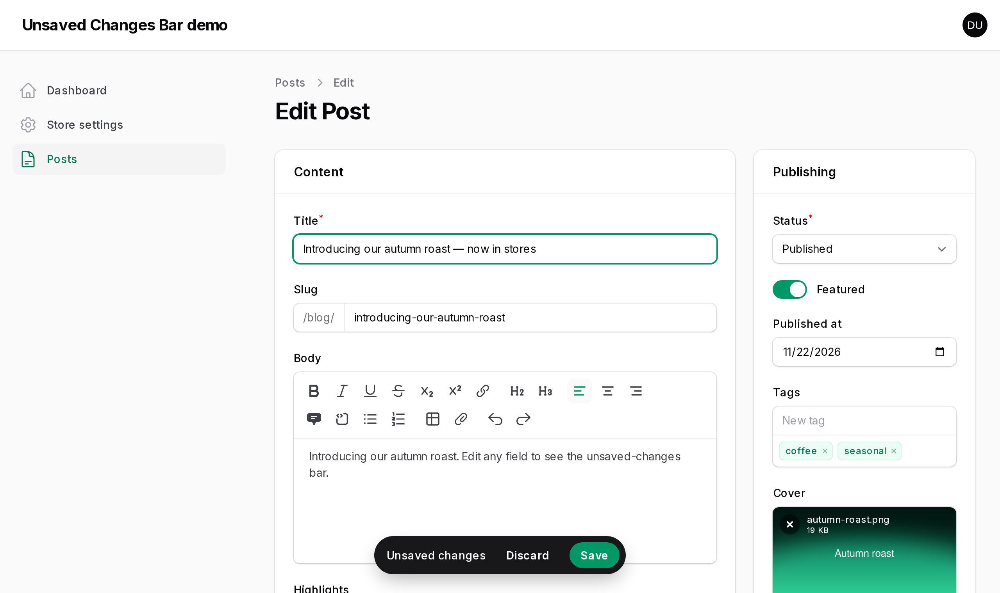
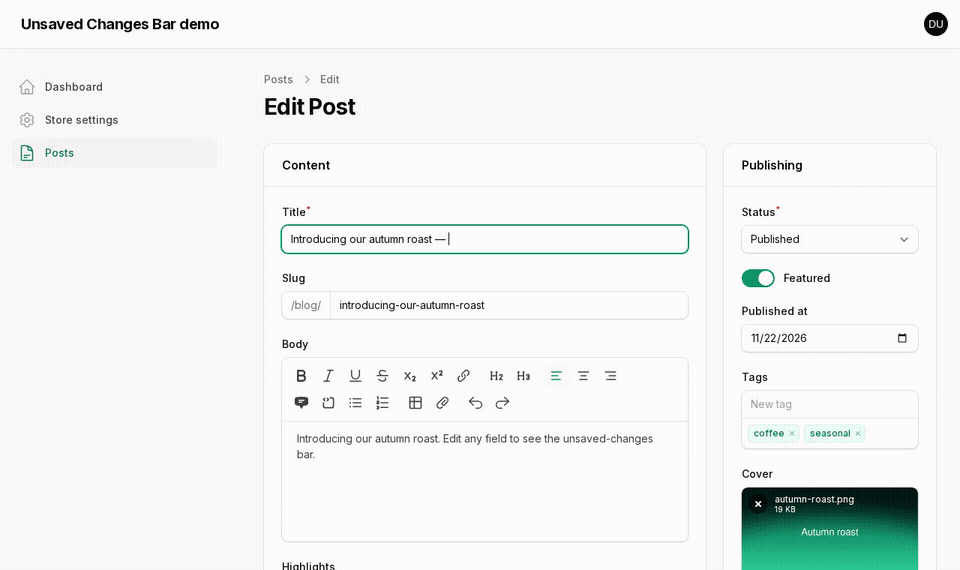
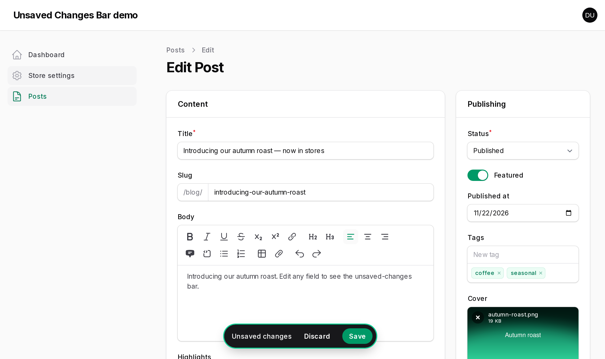

# Filament Unsaved Changes Bar

[](https://github.com/solutionforest/filament-unsaved-changes-bar/actions/workflows/tests.yml)

A floating **"Unsaved changes · Discard · Save"** bar for Filament panel forms, in the style of Shopify and Laravel Cloud. It slides in as soon as a form is edited and disappears once the changes are saved, discarded, or typed back to their original values.





- **Filament 4 and 5** (Livewire 3 and 4), PHP 8.2+.
- **Works out of the box** on every resource `EditRecord` and `CreateRecord` page. You don't need the panel's `unsavedChangesAlerts()`.
- **Same dirty check as Filament**: the hash is computed the same way as Filament's built-in alert, so the two never disagree.
- **SPA-aware**: while the form is dirty, sidebar links don't navigate. The bar shakes instead of opening a `confirm()` popup.
- **Field-safe**: an untouched form with a RichEditor, FileUpload, Repeater or TagsInput never shows the bar.
- Light and dark mode, uses your panel's primary colour, `role="status"` for screen readers, and respects reduced motion.
- Translations: `en`, `zh_TW`, `zh_CN`.

## Installation

```bash
composer require solutionforest/filament-unsaved-changes-bar
php artisan filament:assets
```

Register the plugin on your panel:

```php
use SolutionForest\FilamentUnsavedChangesBar\UnsavedChangesBarPlugin;

public function panel(Panel $panel): Panel
{
    return $panel
        // ...
        ->plugin(UnsavedChangesBarPlugin::make());
}
```

The bar now appears on all Edit and Create pages in that panel.

### Recommended: add the trait

Add `HasUnsavedChangesBar` to a page to make **Discard** reset the form on the server, without a page reload:

```php
use SolutionForest\FilamentUnsavedChangesBar\Concerns\HasUnsavedChangesBar;

class EditPost extends EditRecord
{
    use HasUnsavedChangesBar;
}
```

| | With the trait | Without the trait |
|---|---|---|
| Dirty baseline | Server-side hash, refreshed after every save | Taken in the browser from the first rendered state |
| **Discard** | Refills the form from the record (Edit) or defaults (Create). No reload. | Asks for confirmation, then reloads the page |

## Options

```php
UnsavedChangesBarPlugin::make()
    ->position('top')                  // 'bottom' (default) | 'top'
    ->hideFormActionsWhenDirty()       // hide the page's own Save/Cancel buttons while the bar is visible
    ->guardNavigation(false)           // default true: block SPA navigation and shake the bar
    ->pages([EditPost::class])         // only these pages (also enables custom pages with a save() method)
    ->excludePages([CreateTag::class]);
```

To turn the bar off on a single page:

```php
protected bool $hasUnsavedChangesBar = false;
```

To change the labels, publish the translations:

```bash
php artisan vendor:publish --tag=filament-unsaved-changes-bar-translations
```

| Light | Dark | Navigation blocked |
|---|---|---|
|  |  |  |

## Custom pages

Any Filament page can show the bar if it:

1. uses `InteractsWithForms` and binds its form with `->statePath('data')` to a public `$data` array,
2. has a save method (`save` by default), and
3. uses the `HasUnsavedChangesBar` trait, or is listed in `->pages([...])`.

```php
class StoreSettings extends Page implements HasForms
{
    use HasUnsavedChangesBar;
    use InteractsWithForms;

    public ?array $data = [];

    public function mount(): void
    {
        $this->fillForm();
    }

    // Discard calls this to reload the saved values.
    public function fillForm(): void
    {
        $this->form->fill(StoreSetting::current()->only(['store_name', 'support_email']));
    }

    public function save(): void
    {
        StoreSetting::current()->update($this->form->getState());

        $this->rememberUnsavedChangesBarData(); // the bar hides after a successful save
    }
}
```

If your save method has another name, override `public static function getUnsavedChangesBarSaveMethod(): string`. The full example is in [`demo/app/Filament/Pages/StoreSettings.php`](demo/app/Filament/Pages/StoreSettings.php).


## How it works

- **Server.** The trait stores `md5(json_encode($data))`, the same formula Filament's `HasUnsavedDataChangesAlert` uses. It refreshes the hash when Filament calls `rememberData()` after a successful save. A failed validation leaves the hash unchanged, so the bar stays visible.
- **Browser.** An Alpine component (`resources/dist/unsaved-changes-bar.js`, no build step) watches `$wire.data` with a 150 ms debounce. It compares the data's hash with the server hash and shows the bar when they differ.
- **Initialising fields.** FileUpload and RichEditor change `data` while they load. 500 ms after load, if you haven't touched anything yet, the bar takes the current state as the new baseline.
- **Navigation.** The bar catches `livewire:navigate` before Filament's own `confirm()` handler, so you only ever see one prompt. Closing the tab or reloading the page shows the browser's native dialog.

## Limitations

- The bar only tracks the page's `$data`. Relation managers, table actions and modals are separate Livewire components, so changes there don't show it.
- When you close the tab or reload, browsers only show their own dialog. No page can replace it with custom UI.
- `hideFormActionsWhenDirty()` hides every `.fi-sc-actions` element inside the page's `<form>`.

## Demo and development

The [`demo/`](demo) folder is a small Filament panel with a Posts resource and a custom Store settings page. It also contains the Playwright browser tests and the script that generates these screenshots. See [`demo/README.md`](demo/README.md).

```bash
composer install
composer demo            # → http://127.0.0.1:8000/admin  (demo@example.com / password)

composer test            # Pest
composer analyse         # Larastan
composer format          # Pint
```

CI (`.github/workflows/tests.yml`) runs on self-hosted runners. It runs:

- Pest on PHP 8.2–8.4 with Filament 4 and 5,
- Larastan and Pint, and
- the Playwright browser tests against the demo app on Filament 4 and 5.

## License

MIT. See [LICENSE.md](LICENSE.md).
