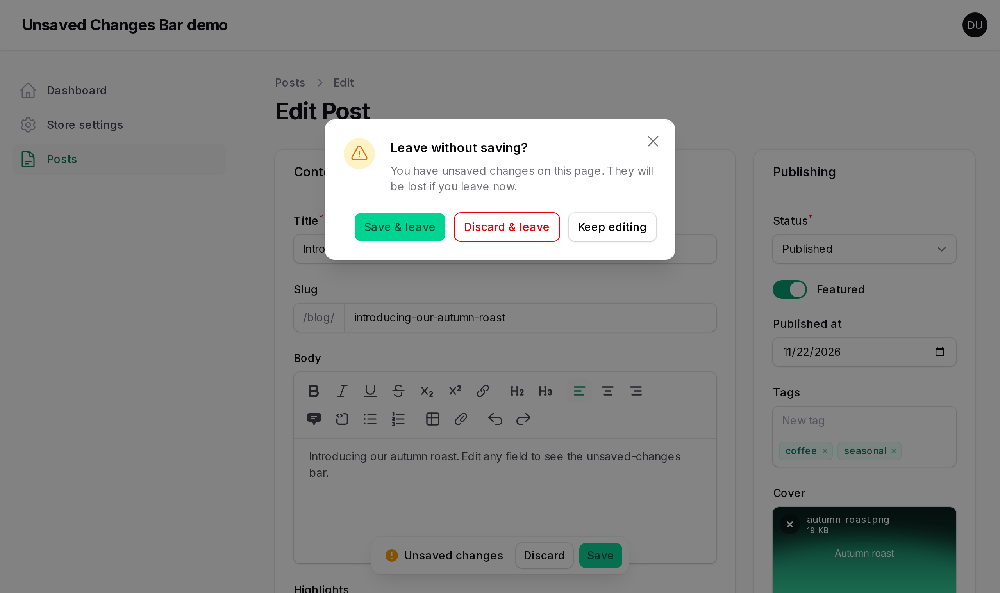
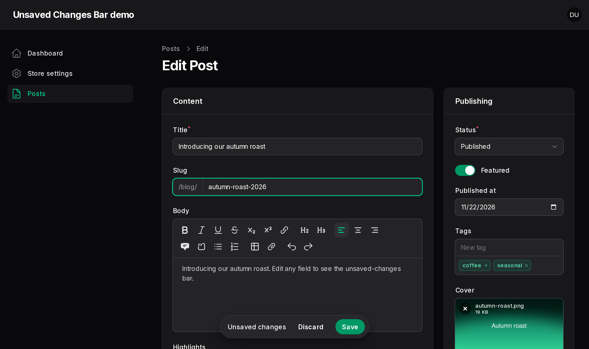
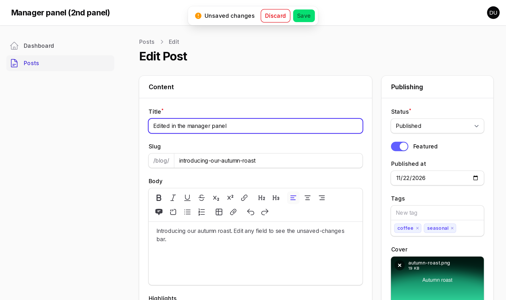
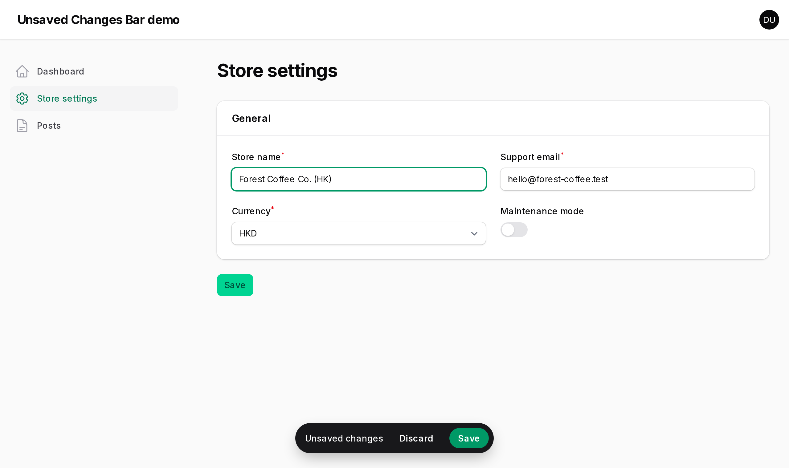

# Filament Unsaved Changes Bar

[](https://github.com/solutionforest/filament-unsaved-changes-bar/actions/workflows/tests.yml)

A floating **"Unsaved changes · Discard · Save"** bar for Filament 5 panel forms, in the style of Shopify and Laravel Cloud. It slides in as soon as a form is edited and disappears once the changes are saved, discarded, or typed back to their original values. If the user tries to leave with unsaved changes, a modal asks what to do with them.


Video: [`docs/images/demo.mp4`](docs/images/demo.mp4)

- **Filament 5** (Livewire 4), PHP 8.2+.
- **Works out of the box** on every resource `EditRecord` and `CreateRecord` page, and on custom pages.
- **Leave modal**: clicking a link while the form is dirty opens a modal with **Save & leave**, **Discard & leave** and **Keep editing**.
- **Filament-native look**: the bar is built from `<x-filament::button>` and `<x-filament::modal>`. It follows your panel's colours and dark mode, and you can pick any registered Filament colour for the buttons.
- **Same dirty check as Filament**: the hash is computed the same way as Filament's built-in alert, so the two never disagree.
- **Field-safe**: an untouched form with a RichEditor, FileUpload, Repeater or TagsInput never shows the bar.
- **Multi-panel and Octane**: each panel has its own configuration. The browser tests run under Laravel Octane (Swoole) in CI.
- Translations: `en`, `zh_TW`, `zh_CN`.

## Installation

```bash
composer require solutionforest/filament-unsaved-changes-bar
php artisan filament:assets
```

Register the plugin on your panel:

```php
use SolutionForest\FilamentUnsavedChangesBar\UnsavedChangesBarPlugin;

public function panel(Panel $panel): Panel
{
    return $panel
        // ...
        ->plugin(UnsavedChangesBarPlugin::make());
}
```

The bar now appears on all Edit and Create pages in that panel.

### Recommended: add the trait

Add `HasUnsavedChangesBar` to a page to make **Discard** reset the form on the server, without a page reload:

```php
use SolutionForest\FilamentUnsavedChangesBar\Concerns\HasUnsavedChangesBar;

class EditPost extends EditRecord
{
    use HasUnsavedChangesBar;
}
```

| | With the trait | Without the trait |
|---|---|---|
| Dirty baseline | Server-side hash, refreshed after every save | Taken in the browser from the first rendered state |
| **Discard** | Refills the form from the record (Edit) or defaults (Create). No reload. | Asks in a Filament modal, then reloads the page |

**Ctrl/⌘ + S** saves while the bar is visible, with or without the trait.

## Pages with several forms

Track every form's state path and reset them all on Discard:

```php
use HasUnsavedChangesBar;

public static function getUnsavedChangesBarStatePaths(): array
{
    return ['profileData', 'notificationsData'];
}

protected function fillUnsavedChangesBarForms(): void
{
    $this->profileForm->fill(/* saved values */);
    $this->notificationsForm->fill(/* saved values */);
}

/** Called by the bar's Save after every form validated, inside a DB transaction. */
protected function persistUnsavedChangesBar(array $states): void
{
    // $states = ['profileData' => [...], 'notificationsData' => [...]]
}
```

The bar's **Save** calls `saveUnsavedChangesBar()`: it validates every form first (one invalid form saves nothing and all errors show), persists via your `persistUnsavedChangesBar()` in one transaction, then refreshes the baseline. State paths map to forms by convention (`profileData` → `profileForm`); override `getUnsavedChangesBarFormName()` to change that. See `demo/app/Filament/Pages/Preferences.php`.

The browser's back / forward buttons are guarded in SPA mode too: the page stays put and the leave modal opens.

## Options

Every option uses an enum or a Filament colour name, so a typo can't silently break it.

```php
use SolutionForest\FilamentUnsavedChangesBar\Enums\BarPosition;
use SolutionForest\FilamentUnsavedChangesBar\Enums\NavigationGuard;

UnsavedChangesBarPlugin::make()
    ->position(BarPosition::Top)                    // BarPosition::Bottom (default) | BarPosition::Top
    ->navigationGuard(NavigationGuard::Modal)       // Modal (default) | Shake | None
    ->saveButtonColor('success')                    // any Filament colour, default 'primary'
    ->discardButtonColor('danger')                  // any Filament colour, default 'gray'
    ->hideFormActionsWhenDirty()                    // hide the page's own Save/Cancel buttons while the bar is visible
    ->includePages([EditPost::class, StoreSettings::class]);   // or ->excludePages([...]), not both
```

### Leaving the page: `navigationGuard()`

| Mode | Clicking a link (sidebar, breadcrumb…), with or without panel `->spa()` while dirty |
|---|---|
| `NavigationGuard::Modal` (default) | Opens a modal: **Save & leave** (saves, then navigates; stays if validation fails), **Discard & leave**, **Keep editing** |
| `NavigationGuard::Shake` | Stays on the page and shakes the bar |
| `NavigationGuard::None` | Doesn't intercept navigation |

Closing the tab or reloading the page always shows the browser's native "Leave site?" dialog. Browsers don't allow any custom UI there. Link clicks are intercepted before the browser navigates, so the modal also works on panels without SPA mode, and the user is never asked twice.



### Choosing pages: `includePages()` / `excludePages()`

- `includePages([...])` shows the bar **only** on the listed pages. It also enables custom pages that have a `save()` method.
- `excludePages([...])` shows the bar everywhere it's eligible **except** on the listed pages.
- Calling both throws `ConflictingPageFilters`, so the configuration can't be ambiguous.
- To opt a single page out, add `protected bool $hasUnsavedChangesBar = false;` to it.

### Colours

The buttons are Filament's own button component. `saveButtonColor()` and `discardButtonColor()` accept any colour registered with Filament: `primary`, `success`, `warning`, `danger`, `info`, `gray`, or your own from `FilamentColor::register()`. The bar's surface follows Filament's cards: white in light mode, `gray-900` in dark mode.

| Light | Dark | 2nd panel: top, success/danger, indigo theme |
|---|---|---|
|  |  |  |

### Translations

To change the labels, publish the translations:

```bash
php artisan vendor:publish --tag=filament-unsaved-changes-bar-translations
```

## Multiple panels

Register the plugin on each panel that should show the bar. Each panel gets its own plugin instance, so the panels can be configured differently:

```php
// AdminPanelProvider
->plugin(UnsavedChangesBarPlugin::make())

// ManagerPanelProvider
->plugin(
    UnsavedChangesBarPlugin::make()
        ->position(BarPosition::Top)
        ->navigationGuard(NavigationGuard::Shake)
        ->includePages([EditPost::class])
)
```

A panel without the plugin shows no bar. The demo has both panels (`/admin` and `/manager`), and both are covered by Pest and browser tests.

## Laravel Octane

The plugin is safe under Octane:

- The plugin instance only holds configuration. Nothing request-specific is stored on it, and there's no static state.
- The render hook is registered through Filament's panel boot, which Filament resets on every request.
- The form state and hash live on the Livewire component.

CI runs the full Playwright suite against the demo served by Octane with Swoole (`composer demo:octane`), as well as against `php artisan serve`.

## Custom pages

Any Filament page can show the bar if it:

1. uses `InteractsWithForms` and binds its form with `->statePath('data')` to a public `$data` array,
2. has a save method (`save` by default), and
3. uses the `HasUnsavedChangesBar` trait, or is listed in `->includePages([...])`.

```php
class StoreSettings extends Page implements HasForms
{
    use HasUnsavedChangesBar;
    use InteractsWithForms;

    public ?array $data = [];

    public function mount(): void
    {
        $this->fillForm();
    }

    // Discard calls this to reload the saved values.
    public function fillForm(): void
    {
        $this->form->fill(StoreSetting::current()->only(['store_name', 'support_email']));
    }

    public function save(): void
    {
        StoreSetting::current()->update($this->form->getState());

        $this->rememberUnsavedChangesBarData(); // the bar hides after a successful save
    }
}
```

If your save method has another name, override `public static function getUnsavedChangesBarSaveMethod(): string`. The full example is in [`demo/app/Filament/Pages/StoreSettings.php`](demo/app/Filament/Pages/StoreSettings.php).



## How it works

- **Server.** The trait stores `md5(json_encode($data))`, the same formula Filament's `HasUnsavedDataChangesAlert` uses. It refreshes the hash when Filament calls `rememberData()` after a successful save. A failed validation leaves the hash unchanged, so the bar stays visible.
- **Browser.** An Alpine component (`resources/dist/unsaved-changes-bar.js`, no build step) watches `$wire.data`. It compares the data's hash with the server hash and shows the bar when they differ.
- **Navigation.** The bar re-checks for changes at the moment you navigate, so typing and then clicking straight away is still caught.
- **Initialising fields.** FileUpload and RichEditor change `data` while they load. 500 ms after load, if you haven't touched anything yet, the bar takes the current state as the new baseline.

## Relation managers, table actions and modals

The bar tracks the page's main form (`$data`). Other components on the page don't need it:

- **Relation manager and table actions save immediately.** Create, edit and delete in a relation manager are written to the database when the action is submitted. There is never an "unsaved" state at page level.
- **Action modals cover the page.** While a modal is open you can't click the sidebar, and Filament already warns on tab close when an action modal is open.
- **If a relation should be part of the bar's Save, put it in the main form.** Use `Repeater::make('items')->relationship()`, or `Select::make('tags')->relationship()->multiple()`. The relation then lives in `$data`, the bar tracks it, and **Save** saves it together with the record. The demo's Highlights repeater shows this nested-array case.

## Limitations

- Closing the tab or reloading the page shows the browser's own dialog. No page can replace it with custom UI.
- `hideFormActionsWhenDirty()` hides every `.fi-sc-actions` element inside the page's `<form>`.

## Demo and development

The [`demo/`](demo) folder contains two Filament panels:

- `/admin`: the default configuration, with a Posts resource and a custom Store settings page.
- `/manager`: the same Posts resource with the bar at the top, success/danger buttons and the shake guard.

It also contains the Playwright browser tests and the script that generates these screenshots and the video. See [`demo/README.md`](demo/README.md).

```bash
composer install
composer demo            # → http://127.0.0.1:8000/admin  (demo@example.com / password)
composer demo:octane     # same app, served by Laravel Octane (Swoole)

composer test            # Pest
composer analyse         # Larastan
composer format          # Pint
```

CI (`.github/workflows/tests.yml`) runs on self-hosted runners. It runs:

- Pest on PHP 8.2–8.4,
- Larastan and Pint, and
- the Playwright browser tests against the demo, served by both `php artisan serve` and Octane (Swoole).

## License

MIT. See [LICENSE.md](LICENSE.md).
