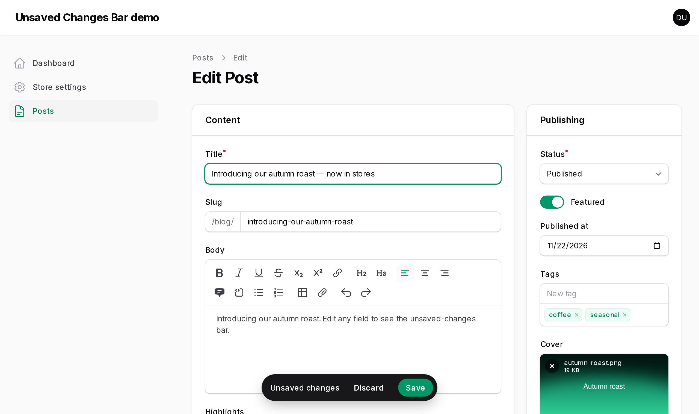

# Demo

This folder is a small Filament panel you can run with the plugin. It runs on [Orchestra Testbench Workbench](https://packages.tools/workbench), so you don't need a separate Laravel app.



## Run it

From the package root:

```bash
composer install
composer demo
```

Open <http://127.0.0.1:8000/admin> and log in as **demo@example.com** / **password**.

`composer demo` rebuilds the SQLite database every time it starts: it migrates, seeds, links storage and publishes the Filament assets. Each run starts from clean data.

## What to try

| Page | Try this | You should see |
|---|---|---|
| **Posts → Edit** | Change the title | The bar slides in |
| | Type the original title back | The bar slides out |
| | Clear the title, then click **Save** | A validation error appears and the bar stays |
| | Edit, then click **Discard** | The saved values come back and the bar hides |
| | Edit, then click **Store settings** in the sidebar | Navigation is blocked and the bar shakes |
| | Edit, then reload the page | The browser's native "Leave site?" dialog |
| | Open the page and don't touch it | No bar, even with the RichEditor, the cover image upload and the repeater |
| **Posts → New** | Type a title, then click **Discard** | The form resets to empty |
| **Store settings** | Edit, then **Save** or **Discard** | A custom (non-resource) page with the same behaviour |

To try the plugin's options, edit `UnsavedChangesBarPlugin::make()` in `app/Providers/AdminPanelProvider.php`. For example, use `->position('top')` or `->hideFormActionsWhenDirty()`.

## Layout

```
demo/
├── app/
│   ├── Filament/Pages/StoreSettings.php       custom page: InteractsWithForms + $data + save() + trait
│   ├── Filament/Resources/PostResource.php    RichEditor, FileUpload, Repeater, TagsInput, Toggle, DatePicker…
│   ├── Models/                                Post, StoreSetting, User
│   └── Providers/AdminPanelProvider.php       the panel and the plugin registration
├── database/                                  migrations and DatabaseSeeder (demo user, posts, cover image)
├── resources/images/cover.png                 seeded cover image for the FileUpload field
└── e2e/                                       Playwright browser tests and the screenshot script
```

The Pest tests in `../tests` reuse these classes.

## Browser tests (Playwright)

The tests in `e2e/tests/bar.spec.js` check the plugin's behaviour in a real Chromium browser. CI runs the same tests on Filament 4 and 5.

```bash
composer demo                       # terminal 1: keep it running
cd demo/e2e
npm ci && npx playwright install chromium
npx playwright test                 # terminal 2
```

Set `DEMO_URL` if the app isn't running on `http://127.0.0.1:8000`.

## Regenerate the README screenshots

```bash
composer demo                            # terminal 1: starts from fresh seed data
cd demo/e2e && node screenshots.mjs      # terminal 2: writes ../../docs/images/*.png and demo.gif (needs ffmpeg)
```
